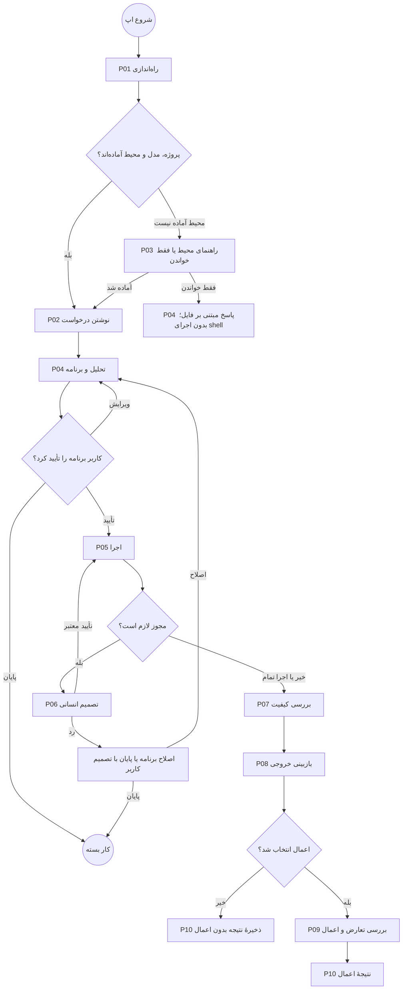
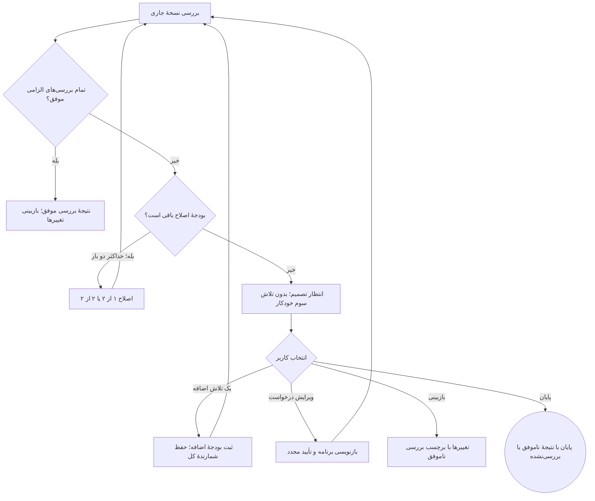
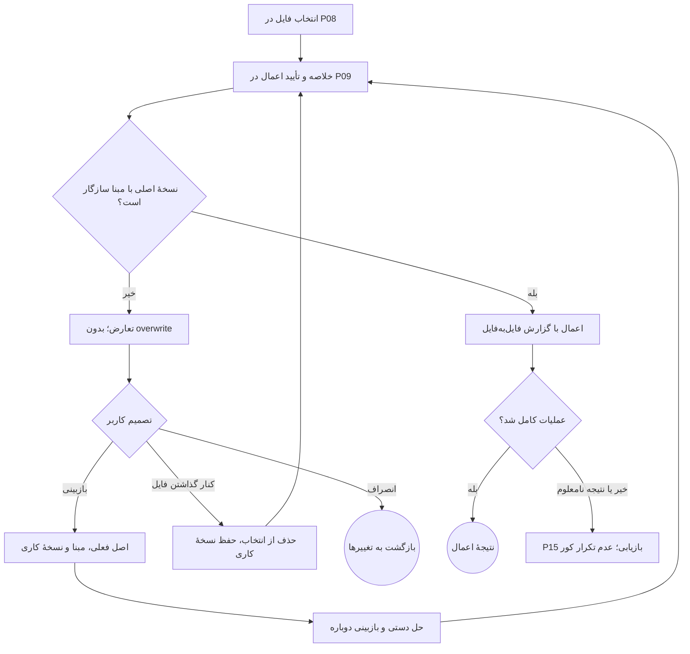

# طراحی محصول Onboard Harness — قرارداد UI/UX نسخهٔ محلی

نسخه: ۱٫۱ — بازنگری کلاسی ۲۵ اکتبر ۲۰۲۶. سطح ارزیابی/انتشار طبق [classroom-scope](../../specs/004-local-harness-execution/classroom-scope.md)؛ همهٔ صفحه‌ها و قابلیت‌ها حفظ شده‌اند. وضعیت: پیشنهاد طراحی آمادهٔ بازبینی و تبدیل به طراحی نهایی/کد؛ هنوز نتیجهٔ آزمون با کاربران یا پیاده‌سازی اپ نیست.

این سند واسط بین [تعریف محصول و معماری](../../specs/003-coding-harness/stage-1-product-definition.md) و [سیستم دیزاین](DESIGN-SYSTEM.fa.md) است. [اطلس تصویری](product-design-atlas.html) چیدمان‌های پیشنهادی را نشان می‌دهد. تمام داده‌های اطلس ساختگی و صرفاً برای توضیح طراحی‌اند.

## ۱. مأموریت Product Designer و تصمیم نهایی

برنامه‌نویس باید بتواند کار را تعریف کند، اختیار لازم را بدهد، پیشرفت را بفهمد، در زمان لازم دخالت کند و تغییر قابل‌بررسی را آگاهانه به پروژهٔ اصلی منتقل کند. رابط باید در هر لحظه به پنج سؤال جواب دهد: «روی چه پروژه‌ای؟»، «الان چه می‌کند؟»، «چه اختیاری دارد؟»، «از من چه می‌خواهد؟» و «کدام نتیجه واقعاً بررسی شده است؟».

واحد اصلی تجربه **یک کار با یک میز کار ثابت** است. برنامه، فعالیت، بررسی کیفیت و تغییرها زیرنمای همین میز کارند؛ برای هر پیام ایجنت صفحهٔ تازه نمی‌سازیم. درخواست تأیید داخل متن گفتگو گم نمی‌شود؛ در جای ثابتی بالای ورودی و در صف تأییدها دیده می‌شود. تنظیمات و Skills به‌عنوان مقصد مستقل از جریان کار باز می‌شوند؛ بازگشت، کار و پیش‌نویس را حفظ می‌کند.

خروجی این نقش عبارت است از معماری اطلاعات، مسیرهای کاربر، مشخصات صفحه‌ها، مدل تعامل، نگاشت نیازمندی به رابط، قواعد استفاده از سیستم دیزاین و معیار پذیرش. انتخاب موتور، API و isolation متعلق به سند فنی است؛ این سند اثر قابل‌دیدن آن تصمیم‌ها را تعیین می‌کند.

## ۲. اهداف کسب‌وکار و نگاشت به رابط

«کسب‌وکار» در این نسخه به ارزش و پذیرش محصول محلی اشاره دارد؛ حساب ابری، اشتراک، پرداخت و تیم در دامنهٔ تعریف‌شده نیستند. اعداد زیر هدف پیشنهادی ارزیابی‌اند و دادهٔ اندازه‌گیری‌شده نداریم.

| شناسه | نیاز محصول | تصمیم طراحی | نشانهٔ موفقیت |
|---|---|---|---|
| B01 | رسیدن سریع به اولین کار واقعی | setup قابل‌ادامه، تشخیص پیش‌نیازها، خانه با یک اقدام اصلی | کاربر بتواند بدون راهنمای شفاهی پروژه و مدل را تنظیم و برنامهٔ کار اول را تأیید کند |
| B02 | واگذاری با اختیار آگاهانه | selector کنار composer، توضیح scope، صف تأییدها | کاربر تفاوت سه mode و دستی بودن apply را درست توضیح دهد |
| B03 | قابل‌فهم بودن کار ایجنت | برنامه، فعالیت جاری، فایل‌ها و Stop همواره در دسترس | کاربر وضعیت فعلی و مانع ادامه را در کمتر از ۱۰ ثانیه پیدا کند؛ هدف آزمون |
| B04 | خروجی قابل اعتماد و قابل ارزیابی | بررسی کیفیت با baseline، نسخه و نتیجهٔ مستقل از پاسخ مدل | هیچ خروجی unverified/stale در UI «بررسی‌شده» نام نگیرد |
| B05 | حفاظت از کار برنامه‌نویس | نسخهٔ کاری جدا، بازبینی فایل و تأیید apply، conflict و restore | کاربر بداند تغییر هنوز در نسخهٔ کاری است یا به اصل منتقل شده |
| B06 | توسعه‌پذیری با Skills | کتابخانه با source، scope، preview و نسخهٔ pinشده | Skill جدید قابل فعال‌سازی باشد و کاربر بداند اختیار جدید خودکار نمی‌گیرد |
| B07 | بازگشت و پشتیبانی بدون وابستگی ابری | تاریخچه، recovery و خروجی تشخیصی محلی | کاربر کار قبلی و دلیل توقف را پیدا کند؛ فرمان نامعلوم خودکار تکرار نشود |

## ۳. اصول اولویت و حدود دامنه

۱. وضعیت واقعی موتور مقدم بر روایت مدل است. «پاس شد»، «اعمال شد» و «متوقف شد» فقط از نتیجهٔ ثبت‌شده نمایش داده شوند.

۲. کنترل اصلی هر نما از هدف همان لحظه می‌آید: قبل از اجرا «تأیید برنامه»، هنگام اجرا «توقف»، هنگام انتظار «بررسی درخواست»، هنگام تحویل «بازبینی تغییرها» و پس از انتخاب فایل «اعمال فایل‌های انتخاب‌شده».

۳. اطلاعات فنی در دو لایه ارائه می‌شود: خلاصهٔ قابل تصمیم‌گیری همیشه پیدا است؛ argv، hash، event و جزئیات runtime در disclosure قرار می‌گیرند. مسیر، فرمان و اثر اقدام حساس نباید پشت disclosure پنهان شوند.

۴. برای v1 ساخت IDE کامل، hunk apply، اجرای روی host، چند worker موازی، marketplace ابری و داشبورد آماری مستقل طراحی نمی‌کنیم. مرور و ویرایش سادهٔ نسخهٔ کاری در دامنه است.

۵. این سند تصمیم‌های UX باقی‌مانده را پیشنهاد می‌کند. آزمایش editor/accessibility، اندازه‌گیری زمان واقعی setup و کارایی دستگاه همچنان لازم است؛ تصویر wireframe اثبات آن‌ها نیست.

## ۴. معماری اطلاعات و مسیرها

مسیرها قرارداد ناوبری پیشنهادی‌اند؛ الزام استفاده از router خاص نیستند. در Electron، بازکردن مسیر باید از وضعیت محلی بازیابی شود.

| شناسه | مقصد | نوع سطح | مسیر پیشنهادی | ورود اصلی |
|---|---|---|---|---|
| P01 | راه‌اندازی اولیه | تمام‌صفحه، ۴ گام | `/setup` | اولین اجرا/ادامهٔ setup |
| P02 | خانه و کار جدید | صفحه | `/home` | شروع برنامه |
| P03 | پروژه و آمادگی محیط | صفحه | `/workspaces/:id` | پروژهٔ جاری/انتخاب پوشه |
| P04 | میز کار: برنامه و گفتگو | صفحهٔ مادر | `/tasks/:id?view=plan` | ارسال درخواست/بازکردن تاریخچه |
| P05 | میز کار: اجرای زنده | زیرنما | `/tasks/:id?view=activity` | تأیید برنامه/مشاهدهٔ اجرای جاری |
| P06 | درخواست‌های تأیید | کارت ثابت + drawer | `/tasks/:id?view=approvals` | کارت انتظار/شمارندهٔ سراسری |
| P07 | بررسی کیفیت و اصلاح | زیرنما | `/tasks/:id?view=checks` | پایان اجرا/شکست بررسی |
| P08 | بازبینی تغییرها | زیرنمای عریض | `/tasks/:id?view=changes` | تحویل/انتخاب فایل |
| P09 | اعمال و تعارض | dialog + زیرنمای P08 | همان task با انتخاب apply | دکمهٔ اعمال |
| P10 | نتیجه و بازگردانی | زیرنما | `/tasks/:id?view=result` | پایان بررسی/اعمال |
| P11 | تاریخچه و صف | صفحه | `/history` | sidebar |
| P12 | Skills | صفحه + جزئیات کناری | `/skills` | sidebar/Skill فعال در کار |
| P13 | تنظیمات مدل و رفتار | صفحه، تب‌بندی | `/settings?tab=models` | sidebar/مدل composer |
| P14 | داده‌ها و پشتیبانی | تب تنظیمات | `/settings?tab=data` | کمبود فضا/خطای راه‌اندازی |
| P15 | بازیابی کار | صفحه/زیرنمای task | `/tasks/:id?view=recovery` | crash/نتیجهٔ نامعلوم |

overlayهای مشترک: انتخاب پوشه، command editor، ویرایش برنامه، جزئیات grant، درخواست شبکه/نصب، بازگردانی فایل و توقف و خروج. «کار جدید» مقصدی جدا از خانه لازم ندارد؛ خانه با پروژهٔ فعلی و composer تازه باز می‌شود.

sidebar سراسری در سمت راست: نشان و نام → انتخاب‌گر پروژه → «کار جدید» → کار جاری/صف → تاریخچه → Skills → پایین ستون: تنظیمات، وضعیت engine. پوشهٔ پروژه داخل فهرست ناوبری با تنظیمات اشتباه نشود. کلیک فایل در فعالیت، P08 را با همان فایل باز می‌کند؛ کلیک نتیجهٔ check، P07 را با خروجی همان check باز می‌کند.

## ۵. پوسته، جهت و رفتار اندازه‌ها

مرجع اپ ۱۴۴۰×۹۰۰ و حداقل پنجرهٔ مورد پشتیبانی ۱۰۲۴×۶۴۰ است. اطلس آموزشی ممکن است در عرض کوچک خوانا بماند؛ این به معنی پشتیبانی اپ موبایل نیست.

| اندازه | چیدمان |
|---|---|
| عرض ≥۱۳۶۰ | sidebar راست ۲۶۴، inspector چپ ۳۲۰، مرکز حداقل ۶۴۰؛ فضای اضافه به مرکز می‌رسد |
| ۱۱۲۰ تا ۱۳۵۹ | sidebar به rail ۶۴ تبدیل می‌شود؛ inspector قابل pin با مرکز حداقل ۶۴۰؛ اگر جا کم است drawer |
| ۱۰۲۴ تا ۱۱۱۹ | rail ۶۴، مرکز باقی فضا؛ inspector فقط drawer با عرض حداکثر ۴۰۰ |
| صفحهٔ تغییرها در هر عرض | inspector بسته؛ فایل‌ها داخل همان نما با ستون ۲۴۰ و diff باقی فضا؛ در کمبود جا لیست فایل drawer و diff unified |

titlebar برابر ۳۶ و header کاری ۵۶ پیکسل است. مرکز از بالا به پایین: مشخصات کار و وضعیت → تب‌های زیرنما → ناحیهٔ اسکرول → درخواست تصمیم ثابت در صورت نیاز → composer ثابت. بخش جزئیات از مرکز جدا اسکرول می‌شود. composer ارتفاع متغیر ۱۲۰ تا ۲۴۰؛ بزرگ‌تر شدن متن، اسکرول داخلی می‌گیرد. در ۶۴۰ پیکسل ارتفاع، جزئیات برنامه داخل تب می‌رود تا ورودی و تصمیم انسانی از viewport بیرون نروند.

در RTL، ناوبری سمت راست و inspector سمت چپ است؛ کد، terminal، command و diff مستقل LTR هستند. چیدمان دکمه‌ها semantic است: اقدام اصلی در inline-end گروه، ترتیب focus مطابق DOM و خواندن. titlebar ویندوز جهت کنترل‌های سیستم را از OS می‌گیرد. اندازهٔ پنل‌ها در بازهٔ مجاز قابل تنظیم و ترجیحشان محلی ذخیره شود.

## ۶. مسیرهای کلیدی

### ۶.۱ اولین نتیجه

### ۶.۲ شکست بررسی و دو اصلاح

در شاخهٔ ویرایش درخواست، اجرا و تأییدهای لازم پیش از رسیدن دوباره به بررسی انجام می‌شوند. نمودار خلاصه است؛ تغییر برنامه، مجوزهای قبلی را بی‌دلیل معتبر نگه نمی‌دارد.

### ۶.۳ اعمال و تغییر هم‌زمان

## ۷. مشخصات صفحه‌به‌صفحه

### P01 — راه‌اندازی اولیه

**هدف / نیاز:** B01، B02؛ رسیدن به اولین کار بدون پنهان کردن وابستگی مدل و محیط. **ورود:** اولین اجرا یا setup نیمه‌تمام. **خروج:** خانه؛ یا حالت فقط خواندن با توضیح محدودیت.

**چیدمان:** عنوان و نشان در بالا، Stepper چهارمرحله‌ای، محتوای تک‌ستونی با max-width برابر ۸۸۰، یک ناحیهٔ وضعیت زیر فیلدها و footer ثابت «قبلی / ادامه». Stepper فقط به گام طی‌شده اجازهٔ بازگشت می‌دهد. نام گام‌ها: «شروع»، «پروژه»، «مدل»، «محیط».

**محتوا:** گام شروع محل ذخیرهٔ داده و انتخاب «راه‌اندازی واقعی / مشاهدهٔ نمونه»؛ گام پروژه پوشه و خلاصهٔ snapshot/exclusion؛ گام مدل تنظیم اتصال و آزمون؛ گام محیط ردیف‌های engine، WSL/Docker، image و فضای دیسک. اندازهٔ واقعی دانلود قبل از تأیید یا متن «اندازه هنوز مشخص نیست»؛ عدد ساختگی ممنوع.

**تعامل:** پیش‌نویس هر گام حفظ شود؛ «ادامه» فقط به شرط معتبر بودن ورودی همان گام. رد دانلود، کاربر را گیر نمی‌اندازد: راهنما و «ادامه فقط برای خواندن» موجود است. حالت نمونه بنر پایدار «نمونه؛ تغییری در فایل‌های شما ایجاد نمی‌شود» دارد و خروج از نمونه روشن است.

**حالت‌ها:** درحال تشخیص با loading؛ key اشتباه خطای کنار فیلد؛ مدل بدون پشتیبانی ابزار مانع کار تغییردهنده با توضیح؛ محیط غایب مانع shell، نه مانع مشاهدهٔ فایل؛ engine خراب اقدام «تلاش دوباره / عیب‌یابی» دارد. **پذیرش:** بازگشت به گام قبلی key ذخیره‌شده را نمایش نمی‌دهد؛ بدون sandbox هیچ دکمه‌ای اجرای host را شروع نمی‌کند.

### P02 — خانه و تعریف کار

**هدف / نیاز:** B01، B03؛ تبدیل یک هدف روزمره به کار. **ورود:** setup کامل/شروع بعدی/کار جدید. **خروج:** P04 پس از ایجاد کار؛ P03 برای اصلاح پروژه.

**چیدمان:** پوستهٔ ثابت؛ بالای مرکز نام پروژه و وضعیت آمادگی، در میانه عنوان «روی چه چیزی کار کنیم؟» و composer بزرگ؛ پایین آن سه پیشنهاد کوچک «رفع خطا»، «ساخت قابلیت»، «بررسی پروژه» که فقط متن نمونه را در ورودی می‌گذارند. فهرست حداکثر پنج کار اخیر در پایین؛ بدون نمودار مصرف تزئینی.

**محتوا و کنترل:** هدف چندخطی، افزودن مرجع فایل داخل پروژه، مدل، سه حالت مجوز، toggle فقط خواندن و دکمهٔ «شروع کار». نوع کار را ایجنت تشخیص می‌دهد؛ انتخاب نوع کار اجباری نیست. پروژه قبل از start انتخاب شود. فایل خارج پروژه در v1 به‌طور خودکار به دامنهٔ دسترسی افزوده نمی‌شود؛ راهنمای آوردن فایل به پروژه نمایش داده شود.

**حالت‌ها:** بدون پروژه CTA «انتخاب پروژه»؛ بدون مدل «تنظیم مدل»؛ worker مشغول «افزودن به صف» با نام کار جاری؛ offline مدل API متن قابل اصلاح و امکان حفظ draft. **پذیرش:** تعویض پروژه با draft غیرخالی گزینهٔ «انتقال متن / نگه‌داشتن در پروژهٔ فعلی / انصراف» می‌دهد؛ هیچ reference فایل پروژهٔ قبلی بی‌صدا منتقل نمی‌شود.

### P03 — پروژه و آمادگی محیط

**هدف / نیاز:** B01، B05؛ مشخص‌کردن دامنهٔ فایل، فرمان‌های بررسی و امکان اجرا. **ورود:** project picker/هشدار readiness. **چیدمان:** سربرگ نام و مسیر، سه تب «فایل‌های قابل استفاده»، «بررسی کیفیت»، «محیط»؛ خلاصهٔ آمادگی و CTA برگشت به کار در بالا.

**فایل‌ها:** درخت با جست‌وجو، شمار فایل و حجم، فایل excluded با دلیل، خلاصهٔ secret/default exclusions، binary و encoding پشتیبانی‌نشده. پیش‌نمایش snapshot با تغییرهای ذخیره‌شدهٔ فعلی کاربر؛ عبارت «فقط آخرین commit» نادرست است. بالاتر از ۵۰۰MB/۵۰هزار فایل تصمیم exclude یا افزایش صریح درخواست شود.

**بررسی:** تشخیص JS/TS یا Python از فایل واقعی؛ پیشنهاد command و cwd با منبع تشخیص؛ required/optional روشن. تأیید «ذخیرهٔ تنظیم» با تأیید نخستین اجرای فرمان یکی نیست. چند lockfile متعارض به انتخاب آگاهانه منتهی شود، بدون حذف خودکار.

**محیط:** ردیف‌های وضعیت و راهنما، آماده/نیازمند تنظیم/پشتیبانی‌نشده. **حالت‌ها:** مسیر جابه‌جا شده → «انتخاب محل جدید» با تطبیق هویت؛ دسترسی ردشده → متن مسیر و راه‌حل؛ snapshot ناموفق → حفظ draft. **پذیرش:** نام پروژه در header و مسیر کامل قابل copy است؛ secrets و بیرون root پیش‌فرض انتخاب نشده‌اند.

### P04 — برنامهٔ کار و گفتگو

**هدف / نیاز:** B02، B03؛ توافق روی محدوده پیش از تغییر. **ورود:** ارسال هدف یا بازنویسی برنامه. **چیدمان:** مرکز گفتگو، inspector چپ برنامهٔ کار؛ در عرض کم برنامه تب است. بالای inspector هدف، revision، محدودهٔ فایل‌ها و وضعیت ویرایش؛ سپس گام‌های منطقی و بررسی‌های پیشنهادی؛ footer «درخواست اصلاح / تأیید برنامه و ادامه».

**تعامل:** ایجنت حین planning فقط خواندن مجاز و تحلیل انجام می‌دهد. برنامه باید scope، گام‌ها، دستورهای بررسی و موارد نامطمئن را نشان دهد؛ متن بلند مدل جای کارت ساختاریافته نیست. کاربر گام را ویرایش/حذف/جابجا کند؛ تغییر dirty ابتدا ذخیره شود و بعد همان revision تأیید شود. اگر revision تازه رسید، دکمهٔ تأیید قدیمی به «برنامه تغییر کرده؛ بازبینی کنید» تبدیل شود.

**Composer مشترک:** متن، فایل مرجع، مدل، مجوز، فقط خواندن و ارسال؛ همهٔ برچسب‌ها همیشه قابل کشف. در این مرحله ارسال پیام توضیحی برنامه را اصلاح می‌کند. **حالت‌ها:** نیاز به سؤال → پاسخ کوتاه با حفظ برنامه؛ scope مبهم → توقف پیش از write؛ رد برنامه → بازنویسی یا پایان. **پذیرش:** ویرایش برنامه هیچ فرمانی را اجرا نمی‌کند؛ برنامهٔ تأییدشده تنها مبنای مجاز همان نسخه است.

### P05 — اجرای زنده و فعالیت‌ها

**هدف / نیاز:** B03، B05؛ دیدن کار واقعی و دخالت به‌موقع. **چیدمان:** header نام کار، پروژه، وضعیت و Stop؛ مرکز خلاصهٔ فعالیت‌های گروه‌بندی‌شده و گفتگو، inspector برنامه و فایل‌های تغییرکرده. تب فعالیت یک timeline با خواندن/ویرایش/فرمان و زمان است؛ stdout هر فرمان disclosure جدا دارد.

**محتوا:** «در حال اجرای آزمون‌ها»، shell، cwd، شروع/مدت/exit code، مسیرهای تغییر، مصرف زمان/call فقط اگر دادهٔ واقعی موجود است. نوار درصد پیشرفت حدسی نداریم. مدل و محیط و مجوز کنار composer قابل مشاهده‌اند. اجرای فعلی با GIF executing در اندازهٔ ۳۲ یا ۴۸ نمایش داده شود؛ فقط یک GIF وضعیت هم‌زمان.

**تعامل:** پیام حین فرمان با برچسب «پس از پایان اقدام جاری به ایجنت می‌رسد» در صف steering قرار می‌گیرد. «توقف» بلافاصله وضعیت «در حال توقف» می‌دهد؛ «متوقف شد» فقط با تأیید runtime. ویرایش دستی فایل حین فرمان ابتدا توقف می‌خواهد؛ inspector فایل را به P08 می‌برد. خواندن پیام قدیمی auto-scroll را متوقف و «پیام تازه» را ظاهر می‌کند.

**حالت‌ها:** SSE قطع → بنر «ارتباط رابط قطع شده؛ وضعیت اجرا در حال بازیابی است»؛ اجرای جدید شروع نشود. timeout/resource → علت جدا و مسیر تصمیم. صف → نام کار منتظر و کار مشغول، بدون درصد ساختگی. **پذیرش:** تغییر صفحه task را تا باز بودن اپ متوقف نمی‌کند؛ بستن اپ وعدهٔ اجرای دائمی نمی‌دهد.

### P06 — تصمیم انسانی و مجوزها

**هدف / نیاز:** B02؛ تصمیم درست بدون درخواست‌های مبهم. **محل:** کارت در بالای composer و drawer جزئیات؛ فهرست چند درخواست با شمارنده در sidebar. پیش‌فرض اولین درخواست مربوط به کار جاری باز است، نه modal پیاپی برای هر event.

**آناتومی کارت:** «این فرمان به تأیید نیاز دارد» → دلیل درخواست → command کامل و cwd با LTR → اثر و محدودهٔ فایل/شبکه → گزینهٔ مدت مجوز → «رد / ویرایش / تأیید و اجرا». action پرریسک تمرکز خودکار روی تأیید ندارد. کلید Enter در command editor فقط newline/ثبت طبق کنترل است؛ تأیید ناخواسته ایجاد نکند.

| حالت selector | توضیح ثابت | اثر UX |
|---|---|---|
| با تأیید | هر تغییر فایل و هر فرمان را پیش از اجرا بررسی می‌کنید | read مجاز خودکار؛ write/command کارت تصمیم |
| مجوز برای همین کار | فقط مجوزهای مشخصی که تأیید می‌کنید تا پایان همین کار باقی می‌مانند | checkbox پیش‌فرض خاموش «تکرار همین فرمان با همین تنظیمات تا پایان این کار مجاز باشد»؛ grant تازه لازم است |
| خودکار در محیط ایزوله | پس از تأیید برنامه، ویرایش و فرمان آفلاین در نسخهٔ کاری خودکار است | شبکه، نصب، نخستین verifier و اعمال به اصل همچنان تصمیم جدا دارند |

**قواعد:** اجازهٔ همیشگی دستگاهی نداریم. شبکهٔ sandbox از اتصال backend به مدل جدا توضیح داده شود. تغییر command/cwd/env/برنامه نسخهٔ قبلی درخواست را نامعتبر می‌کند؛ revalidate قبل از اجرا. رد درخواست، task را به تصمیم/اصلاح هدایت می‌کند، نه تکرار همان سؤال. grantهای جاری در drawer قابل revoke؛ کاهش mode اقدام جاری را قطع نمی‌کند، Stop جداست.

**حالت‌ها:** درخواست منقضی/قبلاً تصمیم‌گیری‌شده read-only با نتیجه؛ دو کلیک فقط یک درخواست تصمیم؛ deny policy دکمهٔ دورزدن ندارد. **پذیرش:** کاربر پیش از تأیید می‌داند چه چیزی، کجا و برای چه مدتی مجاز می‌شود؛ اصل پروژه همیشه خارج این مجوز خودکار است.

### P07 — بررسی کیفیت و اصلاح خودکار

**هدف / نیاز:** B04؛ تبدیل ادعای کیفیت به مدرک. **چیدمان:** نوار جمع‌بندی نسخهٔ بررسی‌شده، جدول checks، پنل خروجی ردیف انتخاب‌شده و footer تصمیم. ستون‌ها: نام، command/cwd، الزامی، نتیجهٔ اولیه، نتیجهٔ فعلی، زمان/نسخه. عرض کم: کارت ردیفی با همین اطلاعات، نه حذف baseline.

**نتیجه‌ها:** موفق، ناموفق، اجرا نشده، تنظیم نشده، متوقف، پایان مهلت و «نیاز به بررسی مجدد» برای stale. baseline failure با عنوان «پیش از تغییر هم ناموفق بود» نشان داده شود؛ همچنان اگر check الزامی جدید fail است، جمع‌بندی سبز نمی‌شود. خطای نصب/شبکه از شکست assertion جدا نوشته شود.

**تعامل:** اولین اجرای command تأیید می‌خواهد؛ فرمان حدسی اجرا نشود. شکست → اصلاح ۱ از ۲، سپس بررسی؛ شکست دوباره → اصلاح ۲ از ۲؛ شکست بعدی کارت ثابت «دو بار اصلاح انجام شد؛ چگونه ادامه دهیم؟» با چهار انتخاب: «یک تلاش دیگر»، «ویرایش درخواست»، «بازبینی خروجی فعلی»، «پایان کار». افزایش بودجه صریح، شمارندهٔ کل و زمان/هزینهٔ قابل‌برآورد را نشان دهد؛ تخمین هزینه در نبود داده «نامشخص» است.

**پذیرش:** فقط عبور تمام checks الزامی نسخهٔ جاری به «بررسی‌ها موفق بودند» و success GIF منتهی می‌شود. ویرایش دستی/formatter بعدی نتیجهٔ مربوط را stale می‌کند. تغییر tests برای سبزکردن بدون تغییر برنامه و تأیید در UI به‌عنوان راه‌حل عادی پیشنهاد نشود.

### P08 — تغییرها و ویرایش دستی

**هدف / نیاز:** B05؛ تصمیم دربارهٔ کد و حفظ کنترل مستقیم. **چیدمان:** header تعداد فایل‌ها/خطوط، وضعیت کیفیت و «اعمال فایل‌های انتخاب‌شده»؛ راست فهرست فایل ۲۴۰، باقی diff؛ inspector بسته. toolbar نمایش unified/دوستونه، wrap و «ویرایش نسخهٔ کاری». گفتگو با دکمهٔ بازگشت یا drawer در دسترس است.

**قواعد:** checkbox انتخاب apply از active file برای مرور جداست؛ پیش‌فرض هیچ فایل برای apply انتخاب نشده، اقدام «انتخاب همهٔ فایل‌های قابل اعمال» آشکار است. فقط apply در سطح فایل؛ hunk checkbox نداریم. added/deleted/modified/binary/unsupported با آیکون و متن. binary بدون diff متنی همراه metadata و در صورت عدم پشتیبانی بدون apply.

**ویرایش:** label ثابت «نسخهٔ کاری ایجنت؛ فایل اصلی هنوز تغییر نکرده»؛ ذخیره/لغو، dirty indicator، خطای hash و بازیابی متن تایپ‌شده. هنگام فرمان جاری ابتدا «توقف برای ویرایش»؛ پس از ذخیره، بررسی‌های قبلی stale. ترک editor با dirty → «ذخیره / کنارگذاشتن / ماندن».

**حالت‌ها:** بدون تغییر → توضیح و نتیجه، نه CTA اعمال بی‌اثر؛ فایل بزرگ → نمایش محدود/بازکردن خروجی مجاز؛ encoding غیر UTF-8 → read-only با علت؛ فایل حذف‌شده → تأکید در summary. **پذیرش:** کد LTR، شماره خط لاتین، مسیر فارسی سالم، copy دقیق و نداشتن اعمال بخشی مبهم.

### P09 — اعمال روی اصل و تعارض

**هدف / نیاز:** B05؛ انتقال آگاهانهٔ نسخهٔ کاری. **سطح:** dialog تأیید با خلاصه، سپس نوار پیشرفت در P08؛ خطا/تعارض panel پایدار همان صفحه است، toast کافی نیست.

**dialog:** عنوان «اعمال ۳ فایل روی پروژهٔ اصلی»؛ نام و مسیر مقصد، فهرست ایجاد/ویرایش/حذف، نسخه و تاریخ بررسی، وضعیت stale/failed و قابلیت بازگردانی محدود. primary همین فعل مشخص؛ secondary «بازگشت به بازبینی». حتی حالت خودکار sandbox این مرحله را حذف نمی‌کند.

**فایل‌های بررسی‌نشده:** apply با تصمیم صریح و متن «این نسخه بررسی موفق معتبر ندارد» ممکن است؛ رنگ و برچسب وضعیت عوض نمی‌شود. **تعارض:** فهرست فایل، مبنا/اصل فعلی/نسخهٔ کاری؛ دکمه‌های بازبینی و کنار گذاشتن از انتخاب؛ overwrite اجباری پیش‌فرض ندارد. حل دستی دوباره hash check می‌خواهد.

**اعمال ناقص:** نتیجهٔ فایل‌به‌فایل applied/pending/conflict/unknown؛ موفقیت کلی زودهنگام ممنوع. دکمهٔ تکرار فقط پس از reconcile اقلام pending؛ unknown به P15. **پذیرش:** بستن dialog در حال apply درخواست ثبت‌شده را دوباره ارسال نمی‌کند؛ نتیجه در تاریخچه قابل مشاهده است.

### P10 — نتیجه، شواهد و بازگردانی

**هدف / نیاز:** B04، B05، B07؛ فهم دقیق تحویل. **چیدمان:** عنوان نتیجه و خلاصهٔ هدف؛ سه ناحیهٔ مستقل «چه تغییر کرد؟»، «چه بررسی شد؟»، «روی اصل اعمال شد؟»؛ سپس فایل‌ها/محدودیت‌ها و اقدامات.

**عنوان‌های مجاز:** «بررسی‌ها موفق بودند؛ هنوز اعمال نشده»، «۳ فایل روی پروژهٔ اصلی اعمال شد»، «کار پایان یافت؛ بررسی‌ها ناموفق‌اند»، «پاسخ آماده است؛ تغییری در فایل‌ها ایجاد نشد». عبارت تنها «انجام شد» برای هر چهار حالت کافی نیست.

**اقدامات:** بازبینی تغییرها، کار بعدی با زمینهٔ فعلی، بازکردن پوشه، بازگردانی فایل‌های همین apply. restore ابتدا preview مقصد و hash فعلی؛ اگر فایل بعداً تغییر کرده conflict و انصراف/بازبینی، بدون Git reset کل پروژه. export summary به فایل محلی اختیاری، ارسال بیرونی ندارد.

**پذیرش:** success GIF فقط برای checks موفق، نه صرف پایان پاسخ/اعمال فایل؛ نتیجهٔ readonly بی‌دلیل موفقیت آزمون ندارد. تاریخچه همین جمع‌بندی را نشان می‌دهد.

### P11 — تاریخچه، کار جاری و صف

**هدف / نیاز:** B03، B07؛ ادامهٔ کار بدون گم‌کردن زمینه. **چیدمان:** search + فیلتر پروژه/وضعیت، گروه «نیازمند تصمیم»، «در صف/فعال»، «بسته‌شده»؛ ردیف ۶۴ پیکسل شامل نام، پروژه، وضعیت و آخرین زمان؛ منوی همیشه قابل فوکوس.

**قواعد:** یک worker فعال سراسری؛ کارهای دیگر صف‌اند. کار منتظر تأیید می‌تواند در تاریخچه بماند؛ UI قفل scheduler را حدس نزند، وضعیت صف را از موتور بگیرد. انتخاب ردیف task را در آخرین نمای محلی باز می‌کند؛ کار منتظر تصمیم با بنر/anchor تصمیم باز شود. draft خانه با بازکردن تاریخچه حذف نمی‌شود.

**حذف:** حذف کار بسته با توضیح «تاریخچه و خروجی‌های این کار حذف می‌شوند؛ فایل‌های پروژه حذف نمی‌شوند». کار فعال یا دادهٔ ضروری recovery قابل حذف نیست؛ ابتدا پایان/بازیابی لازم است. **حالت‌ها:** تاریخچه خالی، نتیجهٔ جست‌وجوی خالی، workspace در دسترس نیست و artifact پاک‌شده از هم جدا. **پذیرش:** وضعیت صف با اجرای واقعی اشتباه نشود؛ restart باعث شروع خودکار فرمان نشود.

### P12 — کتابخانهٔ Skills

**هدف / نیاز:** B06؛ افزودن توانایی با شناخت منبع. **چیدمان:** عنوان + «افزودن Skill محلی»، فیلتر شخصی/پروژه/همراه محصول، لیست نام/شرح/source/نسخه و switch؛ drawer جزئیات با preview دستورها، فایل‌ها، scriptها، hash و وضعیت trust.

**افزودن:** انتخاب پوشه → validation ساختار → preview → انتخاب scope و فعال‌سازی. فعال‌سازی ناشناخته تأیید آشکار می‌خواهد. نمایش script «برای اجرا همچنان نیازمند مجوز است»؛ Skill هیچ حالت دسترسی را خودکار افزایش نمی‌دهد. اعتماد به source و اجازهٔ اجرا دو مفهوم مستقل‌اند.

**وسط کار:** task به نسخهٔ مشخص pin است؛ reload متن «در کار بعدی استفاده می‌شود». اگر استفاده در همین کار درخواست شد، توقف/بازبرنامه‌ریزی و تأیید مجدد طبق policy؛ hot reload خاموش نداریم. **حالت‌ها:** نامعتبر، source مفقود، hash تغییرکرده، غیرفعال و فعال مجزا. **پذیرش:** کاربر منبع و محدوده را پیش از enable می‌بیند؛ حذف شخصی، پوشهٔ اصلی انتخابی را بی‌صدا پاک نمی‌کند.

### P13 — تنظیمات مدل، اجرا و دسترس‌پذیری

**هدف / نیاز:** B01، B02؛ پیکربندی روشن بدون زبان زیرساخت اضافی. **تب‌ها:** مدل‌ها؛ رفتار و محدودیت‌ها؛ ظاهر و دسترس‌پذیری؛ داده‌ها و عیب‌یابی (P14). تنظیمات بررسی پروژه به P03 لینک دارد، نه کپی متناقض همان فرم.

**مدل:** protocol، base URL، model id، secret مخفی، «آزمودن اتصال»، نتیجهٔ tool calling/stream/usage و «ذخیره». آزمودن اتصال ممکن است به سرویس مدل درخواست بفرستد؛ متن کنار دکمه. key جدید فقط برای ذخیره/تعویض دریافت شود؛ key ذخیره‌شده به فیلد برنگردد. probe موفق برای model id مشخص است؛ صرف نام provider نشان tested نیست.

**رفتار:** پیش‌فرض مجوز کارهای جدید، زمان run، timeout، بودجهٔ calls و دو repair؛ مقادیر اولیهٔ سند فنی با واحد و توضیح. اثر تغییر بر کار جاری صریح؛ پیش‌فرض فقط کار جدید. شبکهٔ sandbox پیش‌فرض خاموش و grant مستقل دارد. **ظاهر:** dark v1، کاهش حرکت و تنظیم خوانایی کد؛ سوییچ light غیرفعالِ بی‌کاربرد نشان ندهیم.

**حالت‌ها:** draft تنظیمات حفظ، ذخیره ناموفق inline، تغییر بدون ذخیره هنگام خروج prompt. **پذیرش:** هیچ key در toast/log/export دیده نشود؛ اعتبارسنجی endpoint، ذخیره و probe سه مرحلهٔ قابل تفکیک باشند.

### P14 — داده‌های محلی و پشتیبانی

**هدف / نیاز:** B07؛ مدیریت فضا و تشخیص خطا. **چیدمان:** مسیر دادهٔ محصول و حجم دسته‌ها؛ retention/cache؛ سلامت engine و محیط؛ سپس «ساخت بستهٔ عیب‌یابی». مسیر دادهٔ محصول با مسیر پروژهٔ کاری متفاوت label بخورد.

**داده‌ها:** task بسته تا حذف صریح باقی می‌ماند؛ پیش‌فرض پاک‌سازی خروجی موقت حجیمِ کار بسته پس از ۳۰ روز با تنظیم کاربر؛ cache پیشنهادی ۵GB. پیش‌نمایش پاک‌سازی تعداد/حجم/دسته؛ فایل ضروری recovery حذف نمی‌شود. کمبود فضا کار جدید را متوقف می‌کند و پاک‌کردن تاریخچهٔ ضروری را خودکار انجام نمی‌دهد.

**تشخیص:** پیش‌نمایش اقلام ZIP محلی؛ پیش‌فرض نسخه‌ها، خلاصه preflight، خطاها و metadata پالایش‌شده. کد، prompt، diff، key، نام کاربر و مسیر کامل پروژه پیش‌فرض خارج‌اند. افزودن محتوای پروژه انتخاب مستقل؛ فقط «ذخیره روی دستگاه»، بدون upload خودکار.

**پذیرش:** پاک‌سازی دادهٔ محصول به معنی حذف پروژه نیست؛ اصلاح engine و تنظیم Docker دو اقدام متفاوت؛ نتیجهٔ ساخت ZIP با مسیر قابل بازکردن نشان داده شود.

### P15 — بازیابی پس از قطع یا crash

**هدف / نیاز:** B05، B07؛ جلوگیری از اثر تکراری. **ورود:** reconciliation با نتیجهٔ نامعلوم یا apply ناقص. **چیدمان:** بنر هشدار پایدار؛ آخرین وضعیت قطعی، اقدام نامعلوم، زمان و شواهد؛ لیست فایل‌ها/command مرتبط؛ اقدامات تصمیم در پایین.

**متن:** «نتیجهٔ آخرین فرمان مشخص نیست؛ برای جلوگیری از اجرای دوباره، کار متوقف مانده است.» نمایش log/shutdown دلیل، نه تفسیر ساختگی. primary «بازبینی وضعیت و فایل‌ها»، secondary «پایان این کار». اگر backend نتیجه را قطعی بازیابی کرد، ادامه تنها از اقدام امن بعدی و با تصمیم کاربر. دستور نامعلوم با دکمهٔ کلی «ادامه همه» دوباره اجرا نمی‌شود.

**خروج:** پس از قطعی‌شدن وضعیت، برنامه/کار متوقف‌شده؛ یا پایان با گزارش. **پذیرش:** بازشدن اپ هیچ فرمانی را صرفاً به‌خاطر checkpoint تکرار نمی‌کند؛ history علت و تصمیم را نگه می‌دارد.

## ۸. سطوح مداخله و جزئیات مشترک

| موقعیت | سطح UI | علت |
|---|---|---|
| انتخاب مدل/مجوز | popover متصل به composer | حفظ زمینهٔ کار؛ همیشه قابل دسترسی |
| انتظار action | کارت ثابت + drawer | تصمیم منتظر کاربر در اسکرول گفتگو گم نشود |
| ویرایش command | dialog با command کامل و scope | تمرکز روی revision جدید؛ حفظ متن قبلی |
| ویرایش برنامه | همان inspector/تب | برنامه جزئی از کار است؛ فرم دوم نمی‌خواهد |
| apply/restore/delete | dialog تأیید مشخص | اثر مستقیم روی داده و مقصد باید یک‌جا دیده شود |
| conflict و recovery | panel/نمای پایدار | مسئله با toast یا بستن modal حل نمی‌شود |
| ذخیرهٔ موفق تنظیمات/کپی | toast کوتاه | اطلاع فرعی؛ تنها محل نمایش خطا نباشد |
| خروج با کار فعال | dialog دو انتخاب | «ماندن» و «توقف و خروج»؛ گزینهٔ تکراری «لغو خروج» حذف شده است |

focus dialog وارد عنوان/اولین کنترل غیرمخرب، Tab محدود داخل dialog، Escape انصراف فقط وقتی عملیات قطعی شروع نشده و پس از خروج focus به trigger برگردد. در حال apply، Escape فقط نمای جزئیات را می‌بندد و فرمان لغو جعلی نمی‌فرستد. بستن اپ پس از «توقف و خروج» منتظر تأیید runtime تا مهلت محدود است؛ شکست → recovery، نه اعلان دروغین stopped.

## ۹. قرارداد وضعیت در تمام صفحه‌ها

وضعیت task، نتیجهٔ بررسی و وضعیت apply سه محور مستقل‌اند و badgeهایشان با هم ادغام نمی‌شوند.

| وضعیت فنی | متن کاربر | جای نمایش | عمل اصلی | حرکت |
|---|---|---|---|---|
| draft | آمادهٔ شروع | خانه | شروع کار | ثابت |
| queued | در صف اجرا | header/تاریخچه | مشاهدهٔ کار جاری/لغو صف | ثابت |
| planning | در حال آماده‌سازی برنامه | task | توقف | loading |
| awaiting_plan | برنامه آمادهٔ بازبینی است | plan + header | تأیید برنامه | approval |
| executing | در حال اجرا | header + activity | توقف | executing |
| awaiting_action | منتظر تأیید شما | کارت تصمیم + header | بررسی درخواست | approval |
| verifying | در حال بررسی کیفیت | checks | مشاهدهٔ خروجی/توقف | executing |
| repairing | اصلاح ۱ از ۲ / ۲ از ۲ | checks + header | توقف | correcting |
| awaiting_decision / paused_limit | منتظر تصمیم شما | کارت تصمیم | انتخاب ادامه/پایان | approval یا پوستر |
| stopping | در حال توقف | header | انتظار نتیجه | loading؛ بدون تیک |
| recovery_required | نیازمند بازبینی وضعیت | P15 | بازبینی | هشدار ثابت |
| failed / cancelled | متوقف با خطا / لغوشده | نتیجه/تاریخچه | بازبینی/کار جدید | ثابت |
| پایان پاسخ | پاسخ آماده است | نتیجه | مشاهدهٔ نتیجه | ثابت؛ نه تیک بررسی |
| checks passed معتبر | بررسی‌ها موفق بودند | P07/P10 | بازبینی تغییرها | success یک بار |
| apply completed | فایل‌های انتخاب‌شده اعمال شدند | P10 | مشاهده/بازگردانی | ثابت با متن؛ مستقل از success check |

این جدول متن‌نگاری UI برای stateهای controller است؛ backend نباید از label تصویر state استخراج کند. planning شامل هیچ مجوز write نیست. waiting زمان بودجهٔ run فعال را مصرف نمی‌کند. زمان/call باقی‌مانده فقط با عدد واقعی backend.

## ۱۰. کاربرد دقیق سیستم دیزاین در صفحه‌ها

| خانواده | توکن/کامپوننت | قاعدهٔ کاربرد |
|---|---|---|
| پوسته | `bg.canvas`, `bg.sidebar`, `bg.panel` | بوم، ناوبری و inspector سه نقش متفاوت؛ بدون gradient در میز کار |
| محتوای تصمیم | `bg.surface`, `border.default`, radius.card=۸ | کارت برنامه/approval؛ هر event ساده کارت بزرگ نگیرد |
| لایهٔ شناور | `bg.raised`, radius.dialog=۱۲ | popover/dialog با scrim و z سیستم دیزاین |
| اقدام اصلی | `action.primary`, `text.on-brand` | یک مسیر اصلی روشن در هر ناحیهٔ تصمیم؛ متن سبز روی سبز نداریم |
| وضعیت | `state.warning`, `state.danger`, `state.success` | همراه آیکون/متن؛ سبز برند صرفاً موفقیت کیفیت نیست |
| کد و تغییر | `bg.code`, `diff.*`, `syntax.*` | code۱۳/۲۲، مسیر و فرمان LTR، انتخاب متن واقعی |
| فارسی | Vazirmatn، body۱۵/۲۸، label۱۴/۲۴ | نیم‌فاصله، اتصال حروف، عدم split کاراکتر برای motion |
| فاصله و کنترل | grid۸، gap۱۶، padding۲۴؛ control۴۰ | دکمه معمول۴۰، فشرده۳۲، اقدام شروع۴۸؛ icon target حداقل۳۲ |
| تمرکز | `focus.ring`، border.default | focus۲px با فاصله؛ outline در صفحهٔ کد حذف نشود |

لوگوی ثابت در sidebar۲۴، صفحهٔ شروع۴۸؛ wordmark فقط در فضای کافی. استایل برند از Vertex می‌آید، اما چیدمان محصول ابزارمحور است. hero بزرگ و کارت‌های تبلیغاتی وارد task/diff نمی‌شوند. آیکون‌ها از خانوادهٔ Phosphor فعلی؛ نماد و فلش‌های وایرفریم جایگزین asset نهایی نیستند.

**حرکت‌های پذیرفته‌شده:** loading موجود + چهار GIF تأییدشده در `../../outputs/approved-motion-v2/`؛ فایل success آخرین نسخهٔ تبدیل قطعات به تیک است. نمایش app معمولاً۳۲–۴۸؛ در home/setup حداکثر۹۶. GIF پس‌زمینهٔ مات canvas دارد، نه شفاف؛ روی surface متفاوت در محفظهٔ هم‌رنگ نمایش داده شود. reduced-motion، hidden و انتظار طولانی به poster/text تغییر کند. فقط یک حرکت وضعیت فعال در یک نمای کار.

**React Bits:** Aurora فقط خوشامد/setup و با fallback ثابت؛ SpotlightCard فقط انتخاب پروژه/Skill و بدون جلوه روی متن تصمیم؛ Stepper راه‌اندازی؛ ShinyText نهایتاً برچسب فعالیت کوتاه و در نبود GIF، بدون shimmer روی پاسخ طولانی. اجرای upstream و مجوز طبق `REACT-BITS.fa.md`؛ انیمیشن نباید آماده‌شدن اطلاعات را عقب بیندازد. default میز کار بدون WebGL.

## ۱۱. الگوی متن و خطا

| موقعیت | متن پیشنهادی | اقدام بازیابی |
|---|---|---|
| Docker آماده نیست | «محیط ایزوله آماده نیست. فعلاً می‌توانید فایل‌ها را بررسی کنید.» | تنظیم محیط / فقط خواندن |
| قطع رابط | «ارتباط با موتور قطع شده؛ وضعیت کار در حال بازیابی است.» | تلاش اتصال؛ بدون start تکراری |
| تغییر فایل اصلی | «این فایل پس از شروع کار تغییر کرده است.» | مقایسهٔ نسخه‌ها |
| بررسی stale | «بررسی‌ها مربوط به نسخهٔ قبلی فایل‌اند.» | اجرای دوباره / اعمال با تصمیم صریح |
| بودجه دو اصلاح | «دو بار اصلاح انجام شد و بررسی هنوز ناموفق است.» | چهار انتخاب P07 |
| grant منقضی | «این درخواست تغییر کرده است؛ نسخهٔ تازه را بررسی کنید.» | بازکردن درخواست جدید |
| مدل API | «بخش لازم از کد به سرویس مدل انتخابی شما فرستاده می‌شود.» | تنظیم مدل |
| شبکه sandbox | «فرمان‌های این کار می‌توانند از محیط ایزوله به شبکه متصل شوند.» | تأیید محدود/رد؛ مستقل از provider |
| داده حذف‌شده | «خروجی موقت این کار پاک شده؛ خلاصه و نتیجه باقی است.» | مشاهدهٔ خلاصه |

اصطلاح ثابت: Task «کار»، Plan «برنامهٔ کار»، Working copy «نسخهٔ کاری ایجنت»، Original «پروژهٔ اصلی»، Verifier «بررسی کیفیت». از نام‌گذاری «دسترسی کامل به سیستم» برای sandbox پرهیز شود. خطا باید موضوع، اثر و یک راه بعدی داشته باشد؛ stack trace در جزئیات فنی.

## ۱۲. دسترس‌پذیری و حفظ زمینه

تمام کنترل‌ها با keyboard؛ skip link به محتوای کار؛ tabهای واقعی با نقش و وضعیت انتخاب، عنوان صفحه و تغییر focus هنگام ناوبری. aria-live محدود به تغییر مرحله/نیاز تصمیم؛ stdout و streaming هر token را اعلان نکنند. label تصویر متحرک decorative است وقتی متن مجاور موجود است. کنتراست توکن‌ها به‌تنهایی اثبات انطباق editor نیست.

فایل انتخابی، تب، scroll گفتگو و draft به تفکیک کار حفظ شود؛ key هرگز در draft عمومی ذخیره نشود. shortcut پیشنهادی Ctrl+Enter برای ارسال، Ctrl+K ناوبری، Escape بستن لایه؛ قبل از پیاده‌سازی با editor/OS تداخل بررسی شود. shortcut تنها راه Stop یا apply نیست.

ناوبری اجباری به آخر گفتگو نداریم؛ پیام تازه indicator می‌گیرد. toast باعث جابه‌جایی focus نمی‌شود. conflict/recovery تا تصمیم کاربر می‌ماند. تغییر مدل وسط کار برای segment بعدی با ثبت در تاریخچه و تأیید دامنهٔ هزینه/ارسال داده است؛ انتخاب ظاهری مدل نباید فرمان جاری را تغییر دهد.

## ۱۳. نگاشت پنج قابلیت الزامی به UX و معیار پذیرش

| قابلیت | صفحه‌ها | آنچه کاربر می‌بیند و کنترل می‌کند | سناریوی پذیرش |
|---|---|---|---|
| دسترسی محیط و داده | P03، P05، P08 | دامنهٔ پروژه، readiness، shell/cwd، فایل و نسخهٔ کاری | پروژه با مسیر فارسی انتخاب، فایل مجاز خوانده/ویرایش و خروجی فرمان مشاهده شود؛ اصل پیش از apply دست‌نخورده |
| برنامه‌ریزی | P04 | گام، scope، revision، ویرایش و تأیید | کاربر یک گام را تغییر دهد؛ فقط revision ذخیره‌شده و تأییدشده اجرا شود |
| Skill | P12 + inspector P04 | افزودن، preview، source/hash، فعال‌سازی و نسخهٔ کار | Skill محلی فعال و در کار بعدی قابل‌ردیابی استفاده شود؛ grant اضافه نشود |
| کیفیت و اصلاح | P07، P08، P10 | baseline/current، command، دو تلاش، stale و شواهد | شکست اولیه + دو اصلاح دیده شود؛ تلاش سوم بدون تصمیم شروع نشود؛ manual edit نتیجه را stale کند |
| نظارت و ویرایش انسانی | P04، P06، P08، P09، P15 | plan/action edit، سه mode، Stop، apply/restore/conflict | درخواست ویرایش/رد شود، grant تا پایان کار محدود بماند، اصل فقط با تأیید apply تغییر کند |

## ۱۴. تحویل به طراح رابط و توسعه

فریم‌های طراحی با نام `Pxx / state / viewport` ساخته شوند؛ مثال: `P08 / stale-manual-edit / 1440x900`. برای هر صفحه دست‌کم default، empty، loading، error و حالت حساس مرتبط از متن همین سند استخراج شود؛ صفحهٔ فاقد حالت موردنیاز، «آمادهٔ توسعه» نیست. atlas نمای default/حساس منتخب است و جای همهٔ حالت‌ها را نمی‌گیرد.

**ترتیب طراحی و ساخت:** پوسته و P02/P04 → P05/P06 → P07/P08/P09/P10 → P01/P03 → P11/P12/P13/P14/P15. برای ادعای تکمیل عملکرد، هر پنج معیار باید دیده شوند؛ این ترتیب اجازهٔ حذف setup/recovery نمی‌دهد.

| بسته | خروجی قابل تحویل | پذیرش |
|---|---|---|
| معماری اطلاعات | همین فهرست صفحه و مسیرها | همهٔ مقصدها راه ورود و بازگشت دارند |
| طراحی تعامل | جریان‌ها + رفتار کنترل و state | مجوز، stale، دو repair، conflict و recovery روشن‌اند |
| طراحی بصری | atlas و mapping توکن؛ سپس فریم کامل در ابزار طراحی/کد | هیچ رنگ/کامپوننت خودسر خارج قرارداد لازم نیست |
| قرارداد محتوایی | اصطلاحات، متن CTA و خطا | محصول به نتیجهٔ بررسی‌نشده ادعای موفقیت نمی‌دهد |
| تحویل frontend | ID صفحه، layout، data/state و معیار پذیرش | پیاده‌ساز جای دکمه و اثرش را حدس نمی‌زند |
| ارزیابی | سناریوهای بخش۱۵ | نتیجهٔ واقعی جدا از هدف ثبت می‌شود |

## ۱۵. برنامهٔ ارزیابی پیشنهادی

برای پروژهٔ کلاسی، یک walkthrough روی اپ واقعی توسط توسعه‌دهنده یا یک هم‌کلاسی کافی است: setup، درخواست و تأیید برنامه، edit/reject مجوز، شکست و دو repair، manual edit/stale، subset apply/conflict، Skill و بازگشت پس از قطع. سه سناریوی کوچک می‌توانند چند مسیر را پوشش دهند؛ نمونهٔ fake و کار مدل واقعی جدا گزارش شوند.

پژوهش رسمی پنج‌نفره، آستانهٔ آماری موفقیت، اندازه‌گیری funnel و سنجش چنددستگاهی شرط تحویل نیست. keyboard، focus، رنگ و فونت واقعی، خوانایی در دو اندازهٔ مصوب و reduced-motion با مشاهدهٔ مستقیم بررسی شوند؛ ممیزی رسمی screen reader ادعا نشود. خطای مجوز، اشتباه اصل/نسخهٔ کاری یا اعمال اشتباه همچنان مانع پذیرش همان رفتار است.

به‌جای ساخت فریم جدا برای تمام ترکیب‌های state، حالت‌های مرتبط را در خود اپ پیاده و مرور کنید. برای تکمیل طراحی، نصب shadcn/تعریف token کافی نیست؛ صفحهٔ واقعی باید از نظر رنگ، spacing، typography، layout و دارایی‌های مصوب تطبیق پیدا کند.

## ۱۶. تصمیم‌های تکمیلی این تحویل و ابهام‌های حل‌شده

۱. inspector در چپ و sidebar در راست؛ برنامه، اجرا و کیفیت مرحلهٔ مستقل navigational نیستند، زیرنمای همان task هستند.

۲. درخواست حساس کارت پایدار است؛ modal فقط برای ویرایش متمرکز/اعمال/خروج. اعمال فایل پیش‌فرض انتخاب‌شده ندارد تا انتخاب review با مجوز apply اشتباه نشود.

۳. «ماندن» و «لغو خروج» در سند قدیمی یک معنی داشتند؛ در طراحی نهایی فقط «ماندن / توقف و خروج» داریم، مطابق اصلاح سیستم دیزاین.

۴. به‌علت تأیید صریح کاربر، حرکت لوگو آزادتر از متن اولیهٔ سیستم دیزاین است: چرخش، تجزیه و تبدیل به تیک برای وضعیت‌ها مجاز است. master ثابت همچنان کشیده/تغییرشکل داده نمی‌شود. guideline جدید clear-space برابر ضخامت ستون، ۴۰ واحد است؛ عدد ۳۲ متن قدیمی کنار گذاشته شود.

۵. تمام نام‌ها و اعداد سناریوی اطلس نمونه‌اند؛ readiness و نتیجه در اپ از backend می‌آید. اطلس به فایل‌های پروژه دسترسی ندارد و هیچ commandی اجرا نمی‌کند.

۶. انتخاب دقیق image/runtime، سازگاری editor، رفتار network و دادهٔ performance همان موارد آزمایش‌پذیر سند فنی‌اند؛ این سند نتیجهٔ ساخت آن‌ها را جعل نمی‌کند. مرجع تصمیم‌های محصول سند ترکیبی، مرجع ظاهر tokens و این mapping، و مرجع چهار حرکت جدید نسخهٔ تأییدشدهٔ کاربر است.

## ۱۷. تکمیل تعامل پس از بازبینی قرارداد اجرایی

این بخش رفتار P05/P06/P07/P08/P09/P10/P11/P15 را دقیق‌تر می‌کند؛ صفحه یا قابلیت مستقلی اضافه نمی‌کند. قرارداد اجرایی در `../../specs/004-local-harness-execution/` و تعداد تسک‌ها همچنان۱۸ است.

**کیفیت مقصد انتخابی:** در P08/P09 نتیجهٔ بررسی کل نسخهٔ کاری و نتیجهٔ مقصدی که فقط فایل‌های منتخب روی آن اعمال می‌شوند دو برچسب مستقل‌اند. با تغییر انتخاب، preview تازه ساخته شود؛ به‌صورت پیش‌فرض متن «مقصد انتخاب‌شده بررسی نشده» ظاهر می‌شود مگر backend تطبیق کامل manifest/profile/runtime را تأیید کند. انتخاب ناقص ممکن است وابستگی کد را بشکند. مسیرهای روشن: «بررسی مقصد انتخاب‌شده»، «بازگشت و تغییر انتخاب» یا «اعمال بدون بررسی معتبر» با تأیید صریح همان انتخاب. نتیجهٔ کلی تیک سبز از نسخهٔ کاری به مقصد منتقل نمی‌شود. در P10 نیز کیفیت مربوط به snapshot مشخص و وضعیت اعمال فایل‌به‌فایل است.

**ثبات هنگام اعمال:** با model/command فعال دکمهٔ اعمال یا ویرایش/بازگردانی ابتدا «توقف برای بازبینی» می‌خواهد؛ پس از توقف قطعی و گرفتن قفل، preview از نسخهٔ ثابت ساخته می‌شود. در حال apply/restore، ادامهٔ ایجنت و ویرایش متعارض مسدود است؛ پیام «عملیات روی فایل‌ها در حال انجام است» همراه بازگشت به جزئیات نمایش یابد. تغییر اصل/انتخاب/revision، تأیید قبلی preview را نامعتبر می‌کند؛ خطای409 با حفظ انتخاب و راه بازبینی نشان داده شود.

**انتظار و صف:** task منتظر تأیید بدون فرمان/model فعال worker را نگه نمی‌دارد؛ task آمادهٔ دیگر می‌تواند اجرا شود. پس از تأیید، اگر worker مشغول است «تأیید شد؛ در صف ادامه» نمایش داده شود؛ تأیید به معنی شروع فوری یا مجوز نادیده‌گرفتن تغییرهای جدید نیست. در ادامه، تعارض baseline یا مجوز منقضی تصمیم تازه می‌خواهد. نتیجهٔ runtime نامعلوم همچنان P15 دارد، نه ادامهٔ خوش‌بینانه.

**بودجه و بازیابی:** مصرف زمان فعال و تعداد درخواست مدل/ابزار بین تأیید، مکث، segment و restart حفظ می‌شود؛ انتظار انسانی بدون اجرای فعال از زمان کار کم نمی‌کند. «ادامه» بودجه را صفر نمی‌کند؛ افزایش limit اقدام جدا با حفظ consumed count است. snapshot پس از reconnect این اعداد واقعی را نشان دهد؛ اجرای قبلی با operation_id ثابت بازیابی و نه دوباره اجرا می‌شود.
